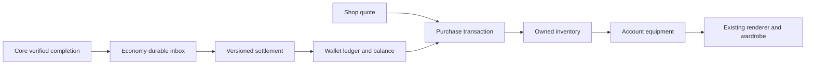

# SHOP implementation backlog

Planning date: October 17, 2026. This breaks development-plan item 6 into
reviewable milestones, including its unfinished WALLET prerequisite. It approves
no earning rates, prices, launch assets, spending, or deployment. No SHOP code is
implemented by this document.

## Scope and architecture

Deliver account-backed coins/in-game Stars, owned skins/backgrounds, persistent
equipment and specific cosmetic purchases at visible prices. Preserve free local
practice and its independent wallet/wardrobe. XTR payments, paid continue, gifts,
loot boxes, trading and leaderboards remain later milestones.

Use the existing Python application and Economy database. Wallet, catalog,
inventory and purchase modules share an Economy transaction; no new service,
broker or distributed purchase transaction is needed. Core continues delivering
verified completion facts and never reads Economy tables.

## Decision gates

| Gate | Decisions / evidence | Blocks |
| --- | --- | --- |
| G0 Foundation | Collect outage/reconnect result; resolve failures; real Telegram account/recovery acceptance | Accepting authenticated runs and enabling SHOP |
| G1 Earning | Eligible completions/accounts, rates by currency, per-life/run/account caps and cap windows, rounding, expiry or none, suspension handling | Production settlement/issuance |
| G2 Historical facts | Whether pre-activation verified facts earn anything; activation boundary and explicit backfill/reconciliation rules | Settlement activation |
| G3 Spending | Spendable provenance, ordering of earned/purchased units, adjustment/refund consequences; purchased funding stays disabled in this slice | Purchase activation; purchased lots require their own PAY approval |
| G4 Catalog | Starter grants, stable item IDs, approved skins/backgrounds/assets/descriptions, prices/currencies, sale eligibility, quote lifetime and delisting behavior | Live catalog, grants and purchases |
| G5 Release | Physical Telegram checks in both languages, pilot access rules, operational acceptance, provider/budget/deployment approval | Hosted rollout |

Recommend one price denomination per offer initially, no conversions, permanent
cosmetic ownership and explicit preview before purchase. These are proposals
until approved. Do not silently make all existing test cosmetics owned or paid.
Account and practice equipment must not overwrite each other's selections.

## Milestones and tasks

Tasks below include meaningful tests first, expected-red execution, focused
verification and worker self-review under root AGENTS.md. Each milestone has its
own branch; keep one implementation owner through revisions.

### M0 — Close prerequisites and freeze contracts

- P0.1 Collect the existing bounded outage test; reconcile acknowledged sequences,
  input ticks and delivery backlog. Record result and any limitation separately
  from managed failover.
- P0.2 Run real Telegram authentication/recovery acceptance with an owner-provided
  test environment. Record desktop/mobile and RU/EN evidence; never claim unit
  tests substitute for this.
- P0.3 Resolve G1–G4 into a versioned policy/catalog decision sheet with examples:
  eligible/ineligible run, cap boundary, delayed/out-of-order fact, first purchase,
  insufficient funds, stale quote and concurrent purchase.
- P0.4 Define versioned API/error contracts and shared IDs before code: wallet,
  settlement status, catalog, quote, purchase lookup, inventory and equipment.
  Define policy selection and ordering for delayed facts and cap windows.
- P0.5 Define migration/rollback and feature-flag sequence. Keep receipt ingestion
  active while issuance/purchasing are off.

Acceptance: no unresolved financial behavior is embedded as an implementation
default; required gates and blocked tasks are explicit.

### M1 — Authoritative WALLET storage and read API

- W1.1 Add Alembic models/migrations for wallets by account/currency, immutable
  ledger transactions/entries, balance projections and unique business references.
  Preserve integer units and currency separation; define overflow bounds.
- W1.2 Implement an internal transactional credit/debit interface. Enforce
  no-overspend with database locking/conditional updates and consistent lock order.
  A cached/read balance must never authorize spending.
- W1.3 Store source provenance, policy version and correlation references. Correct
  errors through linked adjustment entries; never edit historical entries.
- W1.4 Add account-owned wallet/history APIs with bounded pagination and stable
  ordering. Distinguish unavailable state from a genuine zero balance.
- W1.5 Add an audit command that rebuilds/reconciles balance projections from
  entries without issuing currency or silently repairing discrepancies.

Acceptance: real-PostgreSQL tests prove isolation, concurrent debits, integer
bounds, duplicate business operations and ledger reconstruction. No public
arbitrary-credit endpoint. Independent persistence/security review required.

### M2 — Settle verified completion facts

- W2.1 Associate a settlement record with inbox event identity and run/life identity;
  record pending, committed, ineligible or actionable failure and policy version.
  Receipt delivery acknowledgment follows durable inbox acceptance, independent
  of eventual reward settlement.
- W2.2 Implement approved eligibility/rates/caps as deterministic policy functions
  with authored policy fixtures. Reject unsupported versions safely.
- W2.3 Process accepted facts through a bounded restart-safe worker. Atomically
  commit settlement, ledger credit and cap usage; recover work after crashes.
- W2.4 Serialize account/cap updates correctly across concurrent workers. Implement
  the approved delayed/out-of-order event rule rather than relying on arrival order.
- W2.5 Expose per-completion settlement status so verified pickup counts, pending
  credit and spendable balances cannot be confused.
- W2.6 Implement gated activation/backfill according to G2, with dry-run counts,
  audit output and explicit operator authorization before historical credits.

Acceptance: duplicate IDs and new IDs for the same run/life credit once; crash
before/after commit and lost responses do not double-credit; cap boundaries,
ineligible facts, unknown policy and out-of-order facts have documented outcomes.
Existing facts cannot unexpectedly become currency upon deployment.

### M3 — Catalog, owned inventory and equipment

- I3.1 Add stable server catalog IDs mapped to existing cosmetic renderer IDs,
  item type, localized metadata, asset references and sale/availability versions.
  Keep prices on offers; never infer ownership from bundled client assets.
- I3.2 Add unique account/item entitlements with grant provenance. Apply approved
  starter grants idempotently to new and existing eligible accounts.
- I3.3 Add paginated inventory/catalog reads and account equipment read/write APIs.
  Validate ownership, item type and account identity on every equip operation.
- I3.4 Version equipment updates to detect stale cross-device writes; return current
  state on conflict. Define safe rendering fallback for missing assets and preserve
  owned inventory when an offer is delisted.
- I3.5 Load account equipment into the existing wardrobe/renderer with preview,
  explicit Apply and cancel semantics; keep practice preferences separate.

Acceptance: unowned/wrong-type items cannot be equipped; duplicate starter grants
have one effect; reload and another device recover ownership/equipment. Missing
art falls back without changing physics or losing ownership. Independent ownership
review required.

### M4 — Quotes and atomic cosmetic purchases

- S4.1 Persist server-owned, account-bound quotes containing item/offer/version,
  integer amount, currency, expiry and eligibility. Client price claims cannot
  authorize debits.
- S4.2 Add authenticated purchase requests with an idempotency key and canonical
  request fingerprint. Same key/body returns the original operation; conflicting
  reuse fails explicitly.
- S4.3 In one Economy transaction revalidate quote/eligibility/ownership, lock the
  wallet, debit the ledger, grant the entitlement and persist the purchase result.
  Serialize competing purchases and enforce unique permanent ownership.
- S4.4 Add account-owned purchase lookup/list APIs. Persist the committed outcome
  so response loss can recover the same purchase without another debit.
- S4.5 Return stable errors for insufficient funds, expired/stale quote, already
  owned, unavailable offer, ineligible account and idempotency conflict. Never
  silently accept a changed price; require a new visible quote.
- S4.6 Keep purchase separate from equip initially. A successful purchase owns the
  item; the user may then apply it through the wardrobe.

Acceptance: simultaneous buys for the same item create one debit/grant; buys for
different items cannot overspend. Replay after response loss returns the committed
result. Expiry/version races and crash injection preserve all-or-nothing effects.
Independent transaction/security review required.

### M5 — Bilingual wallet/shop user experience

- U5.1 Add account balance and settlement states: loading, ready, pending credit,
  unavailable and reauthentication. Label in-game Stars distinctly from XTR.
- U5.2 Add skin/background catalog browsing, preview, visible price/currency,
  owned/equipped indicators and insufficient-funds explanation.
- U5.3 Present purchase confirmation with the exact quoted item/price. Define
  accessible keyboard/touch flow, focus recovery and localized count/error text.
- U5.4 Retain pending purchase identity by account before sending. Disable duplicate
  submission locally, but rely on server idempotency for correctness. Recover
  uncertain outcomes by lookup/retry of the same operation after reload/login.
- U5.5 Fence old account/session responses; never show one account's wallet,
  inventory or pending operation in another account. Clear scoped UI on logout.
- U5.6 During service failure allow browsing cached presentation with clear stale
  status, but require server confirmation for purchases/equips. Preserve gameplay
  pause behavior; a shop interaction must not also flap.
- U5.7 Add frontend behavior tests for all operation states, storage failure,
  account switches, stale quote refresh and recovery after lost responses.

Acceptance: RU/EN users can inspect, confirm, buy and equip; pending credit is
never presented as spendable. Storage failure cannot cause automatic creation of
a new purchase while the old outcome is unknown. Browser suites remain explicitly
requested checks; physical Telegram acceptance is separate.

### M6 — Integration, capacity and operational acceptance

- V6.1 Test end-to-end verified completion → inbox → settlement → wallet → quote →
  purchase → inventory → equip → reload/second-device recovery against real DBs.
- V6.2 Inject crashes before/after each relevant commit/acknowledgment; test receipt
  and purchase replay, expired authentication, cross-account access, duplicate
  keys, concurrent spending and stale equipment versions.
- V6.3 Complete one batched independent milestone review; return consolidated
  findings to the implementation owner. Rerun affected checks after revisions.
- V6.4 Run final routine checks plus Python/Core/real-PostgreSQL integration checks
  relevant to changed paths. Verify migrations on populated data and rollback
  strategy; never roll back by deleting financial records.
- V6.5 Freeze the tested revision. Measure settlement throughput and mixed gameplay,
  wallet, catalog and purchase traffic. Agree realistic purchase/read rates and
  latency thresholds before running; do not assume 1,000 players buy every second.
  Verify no gameplay regression, overspend, lost committed orders or growing backlog.
- V6.6 Add alerts/runbooks for settlement age, ledger mismatch, unknown purchase
  outcomes, transaction failures and connection saturation. Exercise flag shutdown,
  restoration and safe replay.
- V6.7 Conduct requested browser checks and real Telegram RU/EN acceptance. Hosted
  redundant instances, synchronous database failover, restore drills and rollout
  require the separate provider/budget/deployment approval gate.

Acceptance: evidence names revision, environment and checks. Long jobs have bounded
duration, saved output and collection commands; return control rather than polling.
SHOP activation requires the accepted gates, not merely merged code.

## Proposed persistence and contract boundaries

| Module | Records / operations |
| --- | --- |
| Wallet | Wallet/currency, immutable entries, balance projection, audit |
| Settlement | Policy versions, fact settlement, cap usage, processing leases |
| Inventory | Entitlements, grant provenance, equipment revision |
| Shop | Catalog/offer versions, account quotes, purchase result and idempotency |
| Existing inbox | Immutable verified facts; retained regardless of issuance state |

Proposed browser API families under a versioned Economy prefix: wallet and ledger
history, completion settlement lookup, catalog/quotes, purchases and purchase lookup,
inventory and equipment. Freeze exact schemas in M0; this document does not create
routes. Economy authorization uses validated identity without querying Platform's
database. Core needs no change unless contract review identifies missing evidence;
any shared event change requires compatibility/versioning review first.

## Execution sequence and definition of done

Default sequence: M0 → M1 → M2 → M3 → M4 → M5 → M6.
UI contract prototypes may overlap after M0, but use one implementation worker by
default and avoid simultaneous edits to shared API/models. No separate test-writing
agent. Main agent owns branches, integration and commits; implementation stays with
Luna under root instructions.

For each milestone: settle acceptance → worker TDD/self-review → main review →
batched independent review when required → focused revisions → coherent commit.
Run full suites at integration milestones, not after every small edit.

Done means an eligible verified run credits exactly once under an approved policy;
the account can buy an approved cosmetic once, with no overspend or partial grant;
ownership/equipment survive reload/device changes; uncertain operations recover;
practice and gameplay remain intact; release evidence and open external gates are
reported accurately.

Related: [development plan](DEVELOPMENT_PLAN.md),
[economy policy](MVP_SPECIFICATIONS.md#3-initial-economy-catalog-and-payment-policy),
[architecture](ADR-001-MICROSERVICES.md), [backend evidence](BACKEND_FOUNDATION.md).
